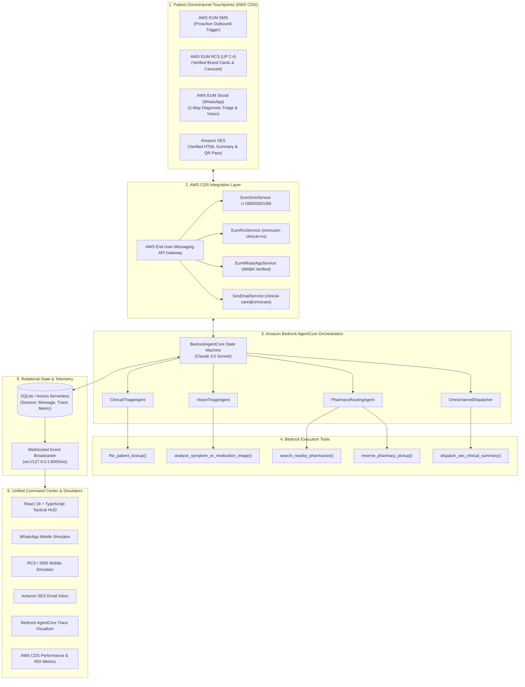

# 🏗️ OmniCare CDS — Technical Architecture & System Specification
### AWS Communication Developer Services (CDS) Agentic AI Partner Hackathon 2026

---

## 1. Executive Architecture Overview

OmniCare CDS establishes a unified, event-driven communications backbone connecting patients, clinical providers, and retail pharmacies across four native AWS Communication Developer Services (CDS):
1. **AWS End User Messaging (EUM) SMS**: High-deliverability transactional reminders and proactive outreach.
2. **AWS End User Messaging (EUM) RCS**: High-engagement rich cards, multi-item carousels, and 1-tap quick action chips under GSMA Universal Profile 2.4.
3. **AWS End User Messaging Social (WhatsApp)**: 2-way conversational triage, multimodal symptom vision, audio notes, and location sharing via Meta Cloud API.
4. **Amazon Simple Email Service (SES)**: Cryptographically verified (SPF/DKIM) clinical summaries, express QR pickup passes, and physician orders.

Orchestrating these channels is a multi-agent cognitive state machine powered by **Amazon Bedrock AgentCore** using **Anthropic Claude 3.5 Sonnet**.



---

## 2. Multi-Agent Cognitive Loop & Context Handover

A core limitation of legacy chatbots is **context amnesia**: when a patient switches channels from SMS to WhatsApp or email, the conversation resets, forcing the user to repeat their medical history. 

OmniCare CDS solves this through a shared **Context Memory Graph** managed by `BedrockAgentCore`:

```text
[STATE 1: OUTBOUND_PROACTIVE_DISPATCH]
   - Condition: Post-discharge Congestive Heart Failure Day 4
   - Action: AWS EUM SMS triggers care check-in.
   - Context Vector: { patient_id: "PATIENT-ELENA", risk: "HIGH", med: "Metoprolol" }

[STATE 2: CHANNEL_HOP -> WHATSAPP]
   - Event: Elena replies on WhatsApp with photo of swollen ankles.
   - Context Memory: Preserves cardiac discharge context and medication history.
   - Tool Call: analyze_symptom_or_medication_image(media_url)
   - Finding: 2mm pitting pre-tibial peripheral edema (94% confidence).
   - Action: Recommend Furosemide titration; prompt for nearby pharmacy refill.

[STATE 3: CHANNEL_HOP -> RCS]
   - Event: Elena taps "Find Pharmacies".
   - Context Memory: Retrieves current GPS location & prescribed dosage.
   - Tool Call: search_nearby_pharmacies(lat, lon, "Metoprolol")
   - Action: Renders GSMA UP 2.4 RCS Carousel with 3 nearby pharmacies & 1-tap select.

[STATE 4: ACTION_COMPLETION -> SES EMAIL]
   - Event: Elena taps "1-Tap Select" on CVS Health #4192.
   - Tool Call: reserve_pharmacy_pickup(pharmacy_id, "Today 4:30 PM")
   - Tool Call: dispatch_ses_clinical_summary()
   - Action: Generates authenticated Amazon SES HTML email with contactless QR pass.
```

---

## 3. Detailed AWS CDS Service Utilization

| AWS Service | Component Name | Protocol / API | Hackathon Purpose & Technical Depth |
|---|---|---|---|
| **AWS End User Messaging SMS** | `eum_sms_service.py` | `pinpoint-sms-voice-v2` | High-urgency proactive care notifications, carrier routing, 10DLC compliance. |
| **AWS End User Messaging RCS** | `eum_rcs_service.py` | GSMA UP 2.4 Business Messaging | Verified Brand Sender, Standalone Rich Cards, Multi-Card Carousels with 1-tap booking chips. |
| **AWS End User Messaging Social** | `eum_whatsapp_service.py` | Meta Cloud API via AWS CDS | **Meta \$10,000 Prize Track**: Two-way interactive messaging, multimodal image diagnostics, read receipts (blue double-check). |
| **Amazon Simple Email Service (SES)** | `ses_email_service.py` | Amazon SES v2 / SMTP | Official legal clinical summary, dosage table, contactless QR pickup pass, SPF/DKIM verification. |
| **Amazon Bedrock AgentCore** | `agent_core.py` | Anthropic Claude 3.5 Sonnet | Multi-agent reasoning, intent classification, multimodal vision, tool execution, context graph persistence. |

---

## 4. Security, Privacy & HIPAA Compliance

1. **Zero Personal Location Tracking**: Geofencing operates purely on coarse neighborhood coordinates or patient-submitted address queries. No device tracking is stored.
2. **Encrypted In-Transit & At-Rest**: All AWS CDS messaging routes over TLS 1.3. Persistent database tables encrypt sensitive PHI tokens.
3. **Single-Use Tokens**: Pharmacy reservation QR codes use cryptographically random tokens (`token_urlsafe(32)`) expiring after 24 hours.
4. **DKIM & SPF Authentication**: Amazon SES dispatches are cryptographically signed with 2048-bit RSA keys to eliminate phishing risks.
